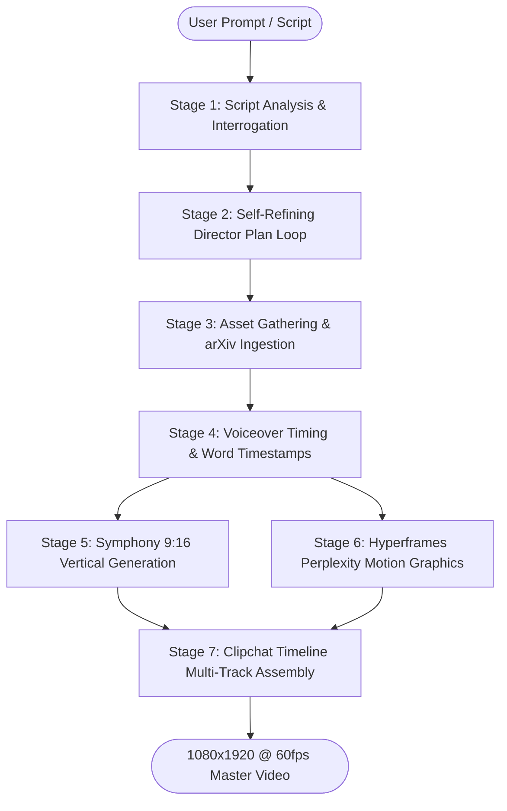

# 🎬 Video-Director: Industrial-Grade AI Video Direction & Motion Graphics System

<p align="center">
  
  
  
  
  
</p>

---

## 📌 Executive Overview

**Video-Director** is a publication-grade video production skill engineered specifically for autonomous AI harnesses: **Google DeepMind Antigravity, Anthropic Claude Code, OpenAI Codex / ChatGPT, xAI Grok Bot, Nous Hermes, and OpenClaw**.

It equips AI agents with the cognitive brain, editorial discipline, and tooling coordination of a world-class motion graphics director and lead technical video editor. The system produces high-retention, publication-ready vertical (**9:16 / 1080x1920**) videos for complex STEM niches: **Artificial Intelligence, Mathematics, Theoretical & Applied Physics, and Computer Systems**.

Every frame, animation, subtitle, and card container strictly adheres to the luxury editorial design language of **Perplexity ([www.perplexity.ai](https://www.perplexity.ai))**: deep matte slates, electric cyan accents, hairline borders, crisp KaTeX mathematical typesetting, and physical spring animations.

---

## 🏛️ The Zero-AI-Slop Manifesto

Most AI-generated videos suffer from tell-tale amateur failure modes: random floating neon particles, nauseating 3D camera tumbling, melting human hands, obnoxious emoji-spam subtitles, and monotonous metronome cuts.

**Video-Director strictly eliminates these failures through 4 Non-Negotiable Directorial Laws:**

```
   [ LAW 1: SYMPHONY IS STRICTLY VERTICAL 9:16 ]
   Symphony creates ONLY 1080x1920 portrait media.
   Every shot is framed with upper-third headroom and vertical leading lines.
   Never request 16:9 widescreen or horizontal pans that crop into illegible mush.

   [ LAW 2: THE 4-TOOL SYNERGY PRINCIPLE ]
   • Do NOT ask Symphony to render text or math (diffusion models hallucinate symbols).
   • Route ALL equations, code, charts, and cards to Hyperframes.
   • Use Symphony exclusively for photorealistic physical hardware and laboratory B-roll.
   • Assemble, cut, duck audio, and grade color exclusively in Clipchat.

   [ LAW 3: THE 0.5-SECOND ARTIFACT TRIM RULE ]
   Video diffusion models suffer from start-frame shock and end-frame drift.
   Clipchat automatically trims the first 0.5s and last 0.5s of every Symphony clip,
   harvesting only the rock-solid middle frames and removing 90% of visible AI warping.

   [ LAW 4: AUDIO LEADS VIDEO & THE NEEDLE DROP ]
   The voiceover performance dictates the cut points—never stretch audio to fit random video.
   Apply J-cuts (audio leads visual cut by 6 frames) and inject a mandatory 0.8s silence
   needle-drop right before every breakthrough revelation or mathematical punchline.
```

---

## ⚙️ The 4-Tool Production Engine



| Engine | Core Responsibility | Directorial Constraints | Primary Tooling |
|---|---|---|---|
| **Symphony** | Photorealistic & stylized AI video/still generation | **Strictly vertical (9:16)**. Never prompt for text or math. Single camera movement per shot. | `tools/symphony_client.py` |
| **Hyperframes** | Programmatic motion graphics, UI simulation, LaTeX math, code diffs | Spring physics (`cubic-bezier(0.16, 1, 0.3, 1)`), matte dark slate cards (`#16191E`), hairline borders (`#23272F`). | `tools/hyperframes_renderer.py` |
| **Clipchat** | Multi-track timeline assembly, J-cuts/L-cuts, audio ducking, LUT color grading | Trims first/last 0.5s of AI generations. Ducks music by -24dB under voice. Applies Perplexity Dark Slate 3D LUT. | `tools/clipchat_compiler.py` |
| **Voiceover Engine** | Neural voice direction, Whisper word timestamps, kinetic subtitles | Intellectual, calm cadence (145 WPM). Subtitles locked to safe baseline (`Y = 1540px`). Glowing cyan active-word highlight. | `tools/voiceover_synthesizer.py`, `tools/subtitle_generator.py` |

---

## 🎨 Perplexity Visual Identity System

All visual components match the editorial aesthetic of **Perplexity ([www.perplexity.ai](https://www.perplexity.ai))**:

### Color Palette Tokens
| Token | Hex Value | Application |
|---|---|---|
| `--pplx-canvas-bg` | `#111418` | Primary dark matte canvas background |
| `--pplx-surface-card` | `#16191E` | Standard elevated card container fill |
| `--pplx-surface-input` | `#1B1F26` | Query search box & citation pill fill |
| `--pplx-border-subtle` | `#23272F` | Hairline 1px card boundary & dividers |
| `--pplx-text-primary` | `#F3F3EE` | Signature warm off-white editorial typography |
| `--pplx-text-secondary` | `#9DA3AE` | Metadata, timestamps, inactive subtitle text |
| `--pplx-accent-cyan` | `#20B8CD` | Perplexity signature brand cyan / active highlight |
| `--pplx-accent-glow` | `rgba(32, 184, 205, 0.22)` | Subtle active-word halo and badge background |
| `--pplx-paper-bg` | `#FBFBF9` | Academic ivory parchment (light paper card inserts) |

### Typography Hierarchy (1080x1920 Canvas)
- **Video Main Hook**: `FK Grotesk` / `Inter Bold`, 56px–64px (`letter-spacing: -0.03em`)
- **Search Query Input**: `Inter Medium`, 38px–44px with blinking cyan cursor
- **Editorial Sub-headings**: `Iowan Old Style` / `Newsreader Italic`, 36px–42px
- **LaTeX Math Equations**: `KaTeX` / `Computer Modern`, 40px–48px with cyan variable highlights
- **Code Blocks**: `JetBrains Mono` / `Berkeley Mono`, 22px–26px with red/green line diffs
- **Citation Badges**: Rounded pill `[1]`, `[2]` with domain favicon and bold cyan index

### Motion Physics & Easing
- **Perplexity Signature Spring**: `cubic-bezier(0.16, 1, 0.3, 1)` (Fast in, smooth mechanical dampening)
- **Entrance Animation**: `translateY(14px) -> translateY(0px)` + `opacity: 0 -> 1` over `320ms`
- **List Stagger Delay**: Exactly `60ms` per successive item

---

## 📐 Vertical (9:16) Safe Zone Grid

Vertical videos displayed on mobile platforms (TikTok, Instagram Reels, YouTube Shorts) have UI overlays on the top, bottom, and right edge. Everything must fit inside the **1080 x 1920 safe coordinate space**:

```
0px ───────────────────────────────────────────────────────────── 1080px
    │                     TOP DEAD ZONE (0 - 220px)             │
    │   [Platform status bar, search bar, sound pills, tabs]    │
220px ├─────────────────────────────────────────────────────────┤
    │               HEADER SAFE ZONE (220 - 450px)              │
    │          [Perplexity Search Bar / Video Hook Card]        │
450px ├─────────────────────────────────────────┬───────────────┤
    │                                           │  RIGHT DEAD   │
    │          HERO ACTION ZONE (450 - 1450px)  │  ZONE         │
    │   • Symphony 9:16 Photorealistic B-Roll   │  (910-1080px) │
    │   • Hyperframes Interactive Cards         │  Like, Share, │
    │   • LaTeX Formulas & Vector DAGs          │  Comment,     │
    │   • Syntax-Highlighted Code Diffs         │  Profile icon │
    │                                           │               │
1450px├─────────────────────────────────────────┴───────────────┤
    │             SUBTITLE SAFE ZONE (1450 - 1640px)            │
    │     [Dynamic word-highlight captions at Y = 1540px]       │
1640px├─────────────────────────────────────────────────────────┤
    │                   BOTTOM DEAD ZONE (1640 - 1920px)        │
    │      [Creator handle, caption description, audio tag]     │
1920px───────────────────────────────────────────────────────────
```

---

## 🗂️ Complete Template Catalog (36 Templates)

All 36 templates in [`templates/`](file:///c:/Users/user/Documents/VIDEO-EDIT-SKILL/templates/) are fully specified with geometry, Hyperframes JSON layouts, and CSS/SVG styling:

### Category 1: UI & Search Interactions (`templates/01-ui-search-interactions/`)
- **`TMPL-01`**: Perplexity Search Query Bar with Animated Keystrokes & Blinking Cyan Cursor
- **`TMPL-02`**: Pro Search Stepwise Reasoning Checklist with Pulsing Active Indicators
- **`TMPL-03`**: Multi-Source Matrix & Domain Badges Grid (`arxiv.org`, `nature.com`)
- **`TMPL-04`**: Interactive Citation Badge & Spring Popover Excerpt
- **`TMPL-05`**: Answer Synthesis Streaming Card with Semantic Headers & Inline Badges
- **`TMPL-06`**: Related Questions Follow-up Pill Stack with Arrow Hover States
- **`TMPL-07`**: Focus Mode Toggle Pill Selector (Academic, Writing, Computational, Web)
- **`TMPL-08`**: Source Fact Verification Drawer (Verified vs Disputed Claims)
- **`TMPL-09`**: Research Collection & Paper Folder Card with Metadata
- **`TMPL-10`**: Executive 3-Bullet Golden Takeaways Summary Container

### Category 2: STEM & Math Visualizations (`templates/02-stem-math-visualizations/`)
- **`TMPL-11`**: Stepwise LaTeX Formula Derivation with Animated Cyan Variable Spotlight
- **`TMPL-12`**: 2D Cartesian Coordinate Grid with Smooth Curve Draw-in & Tangent Slope
- **`TMPL-13`**: 3D Vector Space & Manifold Projection with Basis Vectors $(\mathbf{i}, \mathbf{j}, \mathbf{k})$
- **`TMPL-14`**: Gaussian & Probability Distribution Bell Curve with Shaded $p$-Value Area
- **`TMPL-15`**: Matrix Multiplication & Tensor Dot Product Visualizer ($Q \times K^T$)
- **`TMPL-16`**: Differential Rate Equation with Dynamic Interactive Parameter Slider
- **`TMPL-17`**: Euclidean Geometric Proof & Angle Snapping Construction
- **`TMPL-18`**: Fourier Transform Frequency Spectrum Waveform Decomposition
- **`TMPL-19`**: Physics Free Body Force Vector Diagram (Gravity, Normal, Friction, Tension)
- **`TMPL-20`**: Quantum Qubit State & 3D Wireframe Bloch Sphere Visualizer ($|\psi\rangle$)

### Category 3: AI & CS Architectures (`templates/03-ai-cs-architectures/`)
- **`TMPL-21`**: Transformer Multi-Head Self-Attention Heatmap Matrix
- **`TMPL-22`**: Neural Network Layer DAG & Forward Tensor Flow Animation
- **`TMPL-23`**: Syntax-Highlighted Terminal Code Diff (Red/Green Naive vs Optimal)
- **`TMPL-24`**: GPU/CPU Memory Hierarchy & Bandwidth Waterfall (SRAM vs HBM3e vs DRAM)
- **`TMPL-25`**: Real-Time Terminal Execution Log (Training Loss, LR, TFLOPs)
- **`TMPL-26`**: Competitive Benchmark Bar Showdown with Speedup Multipliers
- **`TMPL-27`**: LoRA Low-Rank Weight Decomposition ($W = W_0 + B \times A$)
- **`TMPL-28`**: KV-Cache PagedAttention & Sliding Window Memory Buffer
- **`TMPL-29`**: Distributed Raft Consensus & Leader Election Topology
- **`TMPL-30`**: Log-Structured Merge (LSM) Tree & SSTable Background Compaction

### Category 4: Narrative Retention Cards (`templates/04-narrative-retention-cards/`)
- **`TMPL-31`**: Academic arXiv Paper Abstract & Golden Sentence Spotlight Card
- **`TMPL-32`**: Myth Buster Dual-Panel Split (Common Intuition vs Mathematical Reality)
- **`TMPL-33`**: Monumental Metric Callout & Animated Ticker Counter ($10,000\times$)
- **`TMPL-34`**: Historical Scientific Quote Plaque in Editorial Serif Typography
- **`TMPL-35`**: Vertical Milestone Spine & Breakthrough Chronology Timeline
- **`TMPL-36`**: Master Summary 3-Card Stack & Bookmark Call-To-Action

---

## 🔬 Complete Case Study Catalog (120 Scenarios)

All 120 case studies in [`case-studies/`](file:///c:/Users/user/Documents/VIDEO-EDIT-SKILL/case-studies/) provide a complete production breakdown (Hook $\rightarrow$ Interrogation $\rightarrow$ Director Plan $\rightarrow$ Assets $\rightarrow$ Symphony Prompts $\rightarrow$ Hyperframes Specs $\rightarrow$ Voiceover Timestamps $\rightarrow$ Clipchat Cut List):

| Domain | Count | Highlight Scenarios |
|---|---|---|
| **AI & Machine Learning** | 30 | FlashAttention SRAM Tiling, LoRA Decomposition, MoE Routing, RoPE Embeddings, PagedAttention, DPO Alignment, Speculative Decoding, Mamba/SSM, AWQ Quantization, Diffusion Langevin Dynamics, DeepSeek MLA Latent Attention |
| **Mathematics & Probability** | 30 | Bayes' Theorem, Eigenvalues & Eigenvectors, Fourier Transform, Monte Carlo Integration, Central Limit Theorem, Markov Chains, SVD Decomposition, Gradient Descent Hessian, Monty Hall Paradox, Euler's Identity, Poincaré Topology |
| **Physics & Quantum Mechanics** | 30 | Schrödinger Wave Equation, General Relativity Geodesics, Double-Slit Wave Collapse, Bell's Inequality Entanglement, Hawking Radiation, Second Law of Thermodynamics, Higgs Mechanism, LIGO Gravitational Waves, Casimir Vacuum |
| **Computer Science & Systems** | 30 | Raft Consensus, LSM Trees vs B-Trees, MESI Cache Coherence, TCP BBR Congestion, zk-SNARKs Zero-Knowledge Proofs, Generational GC Mark-Sweep, Multi-Level Page Tables (TLB), Linux Epoll O(1), Bloom Filters, GPU Warp Scheduling |

---

## 🧰 Standalone Python Tool Suite (`tools/`)

All tools have **zero third-party dependencies** (pure Python standard library) and can be executed via CLI:

```bash
# 1. Universal Model Context Protocol (MCP) Server
# Implements JSON-RPC 2.0 over stdio for Claude Code, Antigravity, OpenClaw, Cursor, Codex
python tools/mcp_server.py

# 2. Automated End-to-End Pipeline Runner
# Orchestrates all 7 stages from topic to 16 production files in one command
python tools/pipeline_runner.py --topic "FlashAttention-2 SRAM Tiling" --domain ai-machine-learning

# 3. Prompt Quality & Anti-Drift Auditor
# Audits Symphony prompts, Hyperframes specs, voice scripts, and timelines against 20 rules
python tools/prompt_auditor.py --all-in projects/flashattention-2_sram_tiling

# 4. Hyperframes Programmatic Motion Renderer
# Compiles templates into standalone HTML5 or 1080x1920 SVG animations
python tools/hyperframes_renderer.py --title "FlashAttention-2" --format svg --out card.svg

# 5. Symphony Vertical 9:16 Client & Prompt Validator
# Enforces strictly 9:16 portrait ratio, PICTURE-916 formula, and blocks negative steering
python tools/symphony_client.py --scene "Silicon cleanroom robotics" --focal 35mm --move "slow push forward"

# 6. Clipchat Multi-Track Timeline Compiler
# Compiles timeline JSON into FFmpeg filtergraph scripts, CMX 3600 EDLs, and HTML visualizers
python tools/clipchat_compiler.py --timeline clipchat_timeline.json --out-script render.bat --out-edl cut.edl

# 7. Neural Voiceover Synthesizer & Timestamp Generator
# Converts math to phonetics, weights pauses, and outputs 48kHz WAV audio + word timestamps JSON
python tools/voiceover_synthesizer.py --script "Your script..." --wpm 148

# 8. Dynamic Subtitle Generator
# Generates .ass karaoke subtitles with active cyan glowing word highlights at safe baseline Y=1540px
python tools/subtitle_generator.py --timestamps timestamps.json --out-ass subs.ass --out-srt subs.srt

# 9. Technical Asset Harvester
# Scrapes arXiv paper metadata, formats citation pill tags [1], and extracts code diffs
python tools/asset_harvester.py --arxiv 2205.14135
```

---

## 🔌 Multi-Harness Adapters (`adapters/`)

Pre-built adapters allow seamless, turnkey integration into any AI coding harness:

| Harness | Quick Start Command | Config File |
|---|---|---|
| **Google Antigravity** | `agy mcp add video-director python c:/Users/user/Documents/VIDEO-EDIT-SKILL/tools/mcp_server.py` | [`adapters/antigravity/SKILL.md`](file:///c:/Users/user/Documents/VIDEO-EDIT-SKILL/adapters/antigravity/SKILL.md) |
| **Anthropic Claude Code** | `claude mcp add video-director python c:/Users/user/Documents/VIDEO-EDIT-SKILL/tools/mcp_server.py` | [`adapters/claude-code/CLAUDE.md`](file:///c:/Users/user/Documents/VIDEO-EDIT-SKILL/adapters/claude-code/CLAUDE.md) |
| **OpenAI Codex** | `python adapters/codex/codex_assistant.py --create` | [`adapters/codex/SYSTEM_PROMPT.md`](file:///c:/Users/user/Documents/VIDEO-EDIT-SKILL/adapters/codex/SYSTEM_PROMPT.md) |
| **xAI Grok Bot** | `python adapters/grok/grok_runner.py` | [`adapters/grok/grok_system.md`](file:///c:/Users/user/Documents/VIDEO-EDIT-SKILL/adapters/grok/grok_system.md) |
| **Nous Hermes** | `python adapters/hermes/hermes_agent.py` | [`adapters/hermes/hermes_prompt.md`](file:///c:/Users/user/Documents/VIDEO-EDIT-SKILL/adapters/hermes/hermes_prompt.md) |
| **OpenClaw** | `python adapters/openclaw/actions.py interrogate '{"topic": "Raft"}'` | [`adapters/openclaw/skill.json`](file:///c:/Users/user/Documents/VIDEO-EDIT-SKILL/adapters/openclaw/skill.json) |

---

## 🧪 Automated Test Suite & Validation

The comprehensive test suite [`scripts/validate_skill.py`](file:///c:/Users/user/Documents/VIDEO-EDIT-SKILL/scripts/validate_skill.py) audits all 201 individual system components:

```bash
python scripts/validate_skill.py
```

```
============================================================
RUNNING VIDEO-DIRECTOR SKILL VALIDATION SUITE
============================================================
1. Validating Master SKILL.md...
2. Validating Sub-Skills...
3. Validating References...
4. Validating Perplexity Design Templates...
  [OK] Verified 36 Perplexity templates (Target: 30-40)
5. Validating Production Case Studies...
  [OK] Verified 120 case studies across 4 domains (Target: 100-200).
       - ai-machine-learning: 30 studies
       - mathematics-probability: 30 studies
       - physics-quantum: 30 studies
       - computer-science-systems: 30 studies
6. Validating Multi-Harness Adapters...
7. Validating Standalone Python Tools...
============================================================
VALIDATION SUMMARY: 201 checks passed.
[SUCCESS] All components validated with 100% compliance across all harnesses and tools!
```

---

## 📖 Agent Operating Guide

If you are an AI assistant or coding agent operating this skill, read the dedicated **[USE-ME.md](file:///c:/Users/user/Documents/VIDEO-EDIT-SKILL/USE-ME.md)** for execution protocols, prompt injection templates, decision trees, and error-recovery playbooks.
