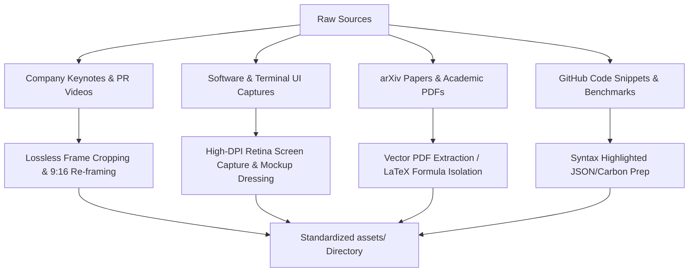

# Sub-Skill: Technical Asset Gathering & Ingestion

A professional technical video director never relies solely on synthetic AI generations. High-credibility videos combine real-world artifacts (official company demo clips, high-DPI software UI, arXiv PDF figures, GitHub code snippets) with Symphony cinematic B-roll and Hyperframes motion graphics.

This sub-skill provides standard operating procedures for sourcing, extracting, and prepping real-world media assets for vertical (9:16) video production.

---

## 1. Asset Category Protocols



---

## 2. Ingesting Company Promotional Videos & Keynotes

When covering an AI model release (e.g. Google Gemini 2.0, DeepMind AlphaFold 3, OpenAI Sora, Anthropic Claude 3.5, NVIDIA Blackwell):

### Sourcing & Selection
- Locate official 4K/1080p source streams (YouTube official channels, corporate press kits, investor day presentations).
- Isolate the **hero demonstration clip** (max 2 to 4 seconds). Never use lengthy screen recordings; grab the single moment of breakthrough interaction (e.g. robot grasping an object, live voice latency response, wafer die inspection).

### 9:16 Re-framing Protocol (Clipchat Prep)
Horizontal (16:9) keynote clips must NEVER simply be squeezed or letterboxed with ugly black bars:
1. **The Dynamic Pan & Scan**: Keyframe a smooth 35mm crop window following the focal action across the 16:9 canvas into 9:16.
2. **The Perplexity Card Inset (Recommended)**:
   Place the 16:9 video clip inside a floating Perplexity rounded container (`border-radius: 16px`, `border: 1px solid #23272F`, `box-shadow: 0 8px 32px rgba(0,0,0,0.6)`) positioned in the upper center of the vertical canvas (`Y = 450px`), while placing citation metadata (`NVIDIA Keynote 2026 [1]`) directly underneath.

---

## 3. High-DPI UI & Terminal Screenshot Protocol

When presenting UI or code executions:

### Capture Guidelines
- Set browser zoom to **150% or 200%** before capturing so that typography is razor-sharp on mobile retina displays.
- Set device emulation or viewport width to **1080px or 1200px**.
- Ensure dark mode is active (`color-scheme: dark`) matching Perplexity `#111418`.
- Crop out irrelevant browser toolbars, bookmark bars, and Windows taskbars unless intentionally demonstrating OS-level integration.

### Terminal & CLI Recordings
- Terminal theme: **Monokai Slate** or **Tokyo Night** (background `#16191E`, foreground `#F3F3EE`).
- Font: `JetBrains Mono` or `Berkeley Mono`, minimum font size 28px.
- Command execution: Record terminal outputs with clean line breaks and zero cursor lag.

---

## 4. arXiv Research Paper & Academic PDF Extraction

Nothing builds authority faster than highlighting the original peer-reviewed paper:

### Extracting Vector Figures & Diagrams
1. Do not take low-res raster screenshots of PDF pages.
2. Open the source PDF and extract figures in vector format (`.svg` or `.pdf` pages).
3. If extracting raster images, render at **300 DPI** minimum (`pdftoppm -png -r 300 paper.pdf page`).

### Paper Abstract Dressing (Perplexity Template `TMPL-31`)
- Extract:
  - Paper Title
  - Primary Authors (e.g. *Vaswani et al., 2017*)
  - Publication Venue (e.g. *NeurIPS, arXiv:1706.03762*)
  - The single defining sentence from the Abstract.
- Render the text inside an academic ivory or slate card with an arXiv badge and Perplexity citation pill `[1]`.

---

## 5. GitHub Code Snippet Preparation

When highlighting algorithms (e.g., FlashAttention CUDA kernel, PyTorch autograd engine, Mamba selective scan):

1. **Prune Ruthlessly**: Reduce the function down to its 5 to 10 core lines of algorithmic truth. Remove boilerplate imports, type guards, and error logging.
2. **Syntax Highlighting**:
   - Background: `#16191E` (Perplexity Surface)
   - Keywords (`def`, `return`, `for`): `#20B8CD` (Cyan)
   - Strings / Literals: `#10B981` (Emerald)
   - Variables / Math Symbols: `#F3F3EE` (Warm White)
   - Comments / Citations: `#646C7A` (Muted Slate)
3. **Line Highlight Callout**: Use Hyperframes to dim unmentioned lines to 35% opacity while the active algorithmic line glows at 100% with a cyan left border indicator.

---

## 6. Directory Ingestion Structure

Organize all gathered media in the project directory before triggering editing:

```
assets/
├── company_pr/
│   ├── deepmind_alphafold_demo_1080.mp4
│   └── nvidia_blackwell_wafer_broll.mp4
├── screenshots/
│   ├── perplexity_search_gemini_retina.png
│   └── huggingface_model_benchmark.png
├── arxiv_figures/
│   ├── attention_is_all_you_need_fig1.svg
│   └── lora_decomposition_schematic.png
└── code_snippets/
    ├── flash_attention_kernel.py
    └── raft_consensus_state_machine.rs
```
